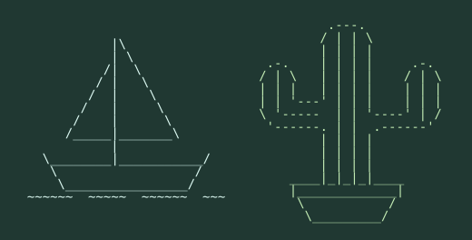
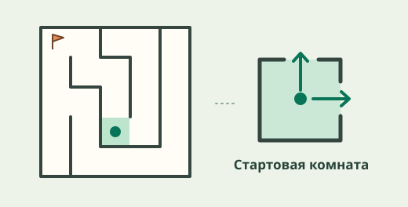
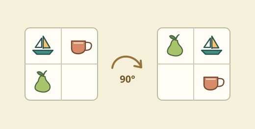
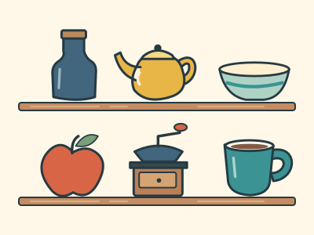
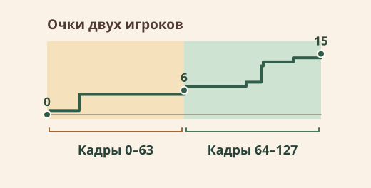

# Spatial Harness Bench · Лидерборд

Обновлено 2026-11-24. [GitHub Pages](https://krestnikov.org/spatial-harness-bench/)

Четыре блока с ASCII, лабиринтами и SVG дают по 22 балла. Аркада даёт 1 балл, пять задач по дому — до 5. В AD&DBench четыре карты, поручение на память и экспедиция дают ещё до 6 баллов.

| Место | Модель | Харнес | Балл из 100 |
| ---: | --- | --- | ---: |
| 1 | GPT-6.2 Astra | Codex 0.171.0 · OpenAI | 99,00 |
| 2 | Opus 5.5 · [Разбор ответов](https://krestnikov.org/spatial-harness-bench/answers/opus-claude-code-20261121/) | Claude Code 2.1.278 · OpenRouter | 92,40 |
| 3 | DeepSeek V4.1 Flash | Claude Code 2.1.278 · OpenRouter | 87,45 |
| 4 | Astra 6 | Claude Code 2.1.278 · OpenRouter | 84,60 |
| 5 | Sonnet 5.5 | Claude Code 2.1.278 · OpenRouter | 62,84 |
| 6 | GigaChat-4 | Pi 0.73.1 / 1.6.0 | 54,64 |
| 7 | Haiku 5.5 | Claude Code 2.1.278 · OpenRouter | 51,79 |

[Поэтажные планы](README.md#building) · [Задачи AD&DBench](README.md#adnd)

## Примеры задач

В пяти задачах модель работает с рисунками, комнатами лабиринта и записью игры. Попробуйте ответить на вопросы по иллюстрациям.

| Иллюстрация | Задача |
| --- | --- |
|  | **ASCII-рисунки** Модель рисует десять предметов, а в новой сессии узнаёт их по силуэтам. Какие два предмета нарисовала Astra? |
|  | **Лабиринт** Модель видит только описание дверей в текущей комнате. Какой первый ход от зелёной точки ведёт к флажку кратчайшим путём? |
|  | **Повороты на поле SVG** Модель следит за своими SVG-рисунками при сдвигах и поворотах. Где окажется парусник после поворота квадрата на 90° по часовой стрелке? |
|  | **Вопросы по SVG-сценам** Модель читает код готовой SVG-сцены. Что стоит под чайником и слева от бирюзовой кружки? |
|  | **Монтажный индекс** Модель строит индекс игровых клипов по 64 кадра. В каком из двух отрезков сильнее вырос общий счёт игроков? |
